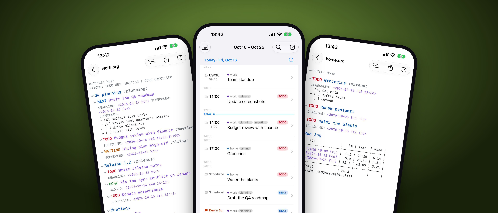

#+OPTIONS: toc:nil

#+ATTR_HTML: :alt orgstar on iPad, Mac and iPhone

orgstar is an editor for [[https://orgmode.org][Org mode]] files on the Mac, iPhone and
iPad. It reads and writes the same plain-text =.org= files Emacs does, and leaves every
byte you didn't change as it was, so Emacs, the Mac app, the iOS app and your sync tool
can all work on the same folder.

[[https://gitbay.org/krz/orgstar/releases][Download for Mac]] ·
[[https://krz.gitbay.site/orgstar/][Manual]] ·
[[file:ios/AppStore/screenshots][Screenshots]]

** Your files stay yours
There is no database of your notes and no account. orgstar works on folders you choose,
in iCloud Drive, a Syncthing folder or anywhere else, and keeps only an index for search
and the agenda, rebuilt from the files whenever they change. Open the same files in
Emacs tomorrow and nothing has been reformatted.

** What it does
- *Editor.* Headings, TODO keywords, priorities, tags, timestamps, links, lists,
  tables and source blocks, styled as you type. Folding, structure editing, and Emacs,
  Mac or Doom (Vim) keys.
- *Agenda.* Scheduled items, deadlines and timestamps from all your files, by day,
  with habits and Calendar events. On the Mac, a board shows entries as a table or as
  kanban columns.
- *Capture.* Capture templates as in Org, from a global shortcut, the share sheet,
  Shortcuts, widgets, or =org-protocol://= links, so existing browser bookmarklets work
  unchanged.
- *Clocking.* Clock in and out of entries, with clock reports and a Live Activity on
  iPhone.
- *Tables.* Aligned as you type, with =#+TBLFM= formulas.
- *Code blocks.* Run source blocks and tangle them into files, as =org-babel-tangle=
  does.
- *Export.* HTML and Markdown built in; PDF, LaTeX, ODT and more through Emacs when
  it is installed.
- *Search.* Across file names, headings and text, plus Spotlight and Quick Look
  previews of =.org= files.

** Coming from Emacs
orgstar behaves the way Org does where the two overlap. Settings ▸ General ▸ Import from
Emacs reads an existing Emacs or Doom configuration and carries over its org settings,
folders, capture templates, key bindings and agenda views. Settings live in plain files
under =~/.config/orgstar/=, so they can sit in your dotfiles next to your Emacs config.

** Get it
On the Mac (macOS 26 or later), with Homebrew:

#+begin_src sh
brew tap krz/tap https://gitbay.org/krz/homebrew-tap.git
brew install --cask orgstar
#+end_src

or download the notarized DMG from the
[[https://gitbay.org/krz/orgstar/releases][releases page]]. The iPhone and iPad app (iOS 26
or later) is built from source with Xcode; see [[file:docs/manual/install.org]].

To build from source or contribute, see [[file:CONTRIBUTING.org]].

License: 0BSD.
