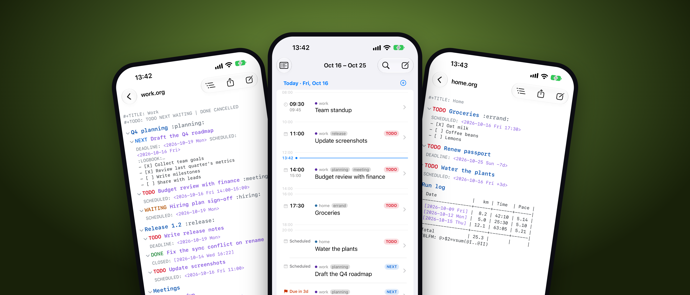

#+OPTIONS: toc:nil

#+ATTR_HTML: :alt orgstar on iPad, Mac and iPhone

Support orgstar through [[https://github.com/sponsors/krazywarez][GitHub Sponsors]].

orgstar is an editor for [[https://orgmode.org][Org mode]] files on the Mac, iPhone and
iPad. It reads and writes the same plain-text =.org= files Emacs does, and leaves every
byte you didn't change as it was, so Emacs, the Mac app, the iOS app and your sync tool
can all work on the same folder.

[[https://apps.apple.com/us/app/orgstar-org-mode-agenda/id6821552018][App Store (Mac, iPhone and iPad)]] ·
[[https://files.krz.sh/orgstar/][Download for Mac]] ·
[[https://files.krz.sh/orgstar/][Manual]] ·
[[file:ios/AppStore/screenshots][Screenshots]]

** Your files stay yours
There is no database of your notes and no account. orgstar works on folders you choose,
in iCloud Drive, a Syncthing folder or anywhere else, and keeps only an index for search
and the agenda, rebuilt from the files whenever they change. Open the same files in
Emacs tomorrow and nothing has been reformatted.

** What it does
- *Editor.* Headings, TODO keywords, priorities, tags, timestamps, links, lists,
  tables and source blocks, styled as you type. Folding, structure editing, and Emacs,
  Mac or Doom (Vim) keys.
- *Agenda.* Scheduled items, deadlines and timestamps from all your files, by day,
  with habits and Calendar events. On the Mac, a board shows entries as a table or as
  kanban columns.
- *Capture.* Capture templates as in Org, from a global shortcut, the share sheet,
  Shortcuts, widgets, or =org-protocol://= links, so existing browser bookmarklets work
  unchanged.
- *Clocking.* Clock in and out of entries, with clock reports and a Live Activity on
  iPhone.
- *Tables.* Aligned as you type, with =#+TBLFM= formulas.
- *Code blocks.* Run source blocks and tangle them into files, as =org-babel-tangle=
  does.
- *Export.* HTML, Markdown, PDF, Word, RTF, ODT, iCalendar, LaTeX and ASCII built in; PDF
  through LaTeX and more through Emacs when it is installed (download version only).
- *Search.* Across file names, headings and text, plus Spotlight and Quick Look
  previews of =.org= files.

** Coming from Emacs
orgstar behaves the way Org does where the two overlap. Settings ▸ General ▸ Import from
Emacs reads an existing Emacs or Doom configuration and carries over its org settings,
folders, capture templates, key bindings and agenda views. Settings live in plain files
under =~/.config/orgstar/=, so they can sit in your dotfiles next to your Emacs config. The Mac
App Store version keeps its own until you choose that folder in Settings ▸ General ▸ Choose
Configuration Folder….

** Get it
The Mac app (macOS 26 or later) comes in two versions:

- From the [[https://apps.apple.com/us/app/orgstar-org-mode-agenda/id6821552018][Mac App Store]]. It runs in the App Sandbox and starts no other programs: Emacs
  Lisp blocks run in orgstar's own interpreter, other languages don't run, and nothing is
  handed to Emacs. Folders outside the ones you add need your permission once.
- As a download, signed with a Developer ID and notarized. It runs code blocks in any
  language installed on the Mac, recalculates the tables and makes the exports orgstar can't
  do itself in Emacs, and updates itself. Install it with Homebrew:

  #+begin_src sh
  brew tap krz/tap https://gitbay.org/krz/homebrew-tap.git
  brew install --cask orgstar
  #+end_src

  or download the DMG from [[https://files.krz.sh/orgstar/][files.krz.sh/orgstar]].

Keep only one of them installed. The manual's Install page lists the differences and how to
move settings between them. The iPhone and iPad app (iOS 26 or later), with its Apple Watch
app, is on the [[https://apps.apple.com/us/app/orgstar-org-mode-agenda/id6821552018][App Store]].

** orgstar+
Editing, the agenda, capture, clocking, tables, search, and HTML and Markdown export are
free. orgstar+ adds running and tangling source blocks; PDF, LaTeX, ODT, Word and rich-text export
and publishing; encrypting entries (decrypting stays free); org-roam nodes, daily notes and
backlinks; widgets, the Apple Watch app and the clock Live Activity; Calendar and Reminders in
the agenda; and Shortcuts actions.

- iPhone, iPad and the Mac App Store version: in-app, $1.99 a month, $19.99 a year or $39.99
  once. One purchase covers all three with the same Apple Account.
- Mac download: by [[https://github.com/sponsors/krazywarez][sponsoring on GitHub]], $60 once for a license key that doesn't expire,
  or $5 a month for a key orgstar renews while you sponsor. Sign in with GitHub at
  [[https://krz.sh/apps/orgstar/license][krz.sh/apps/orgstar/license]] for the key and enter it in Settings ▸ orgstar+.

Anyone who installed the iOS app or the Mac download before orgstar+ keeps every feature
without buying it.

On iPhone and iPad, anyone can also leave a one-time tip in Settings ▸ About orgstar, and in
the Mac App Store version in Settings ▸ orgstar+. Tips unlock nothing.

To build from source, contribute or release (the Mac download, the Mac App Store and the iOS
App Store), see
[[file:CONTRIBUTING.org]].

Copyright © 2026 Christian Cleberg. All rights reserved; see [[file:LICENSE]].
